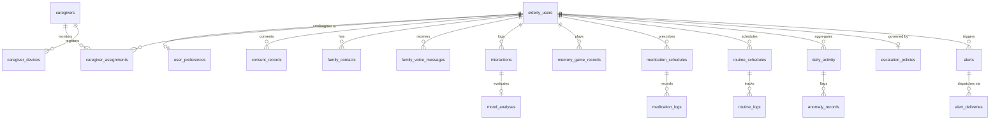

# Presence: Database Schema Specification

> **System Design Specification (SDS 2.3) Relational Schema Reference**  
> **Database Engine:** PostgreSQL 14+  
> **Primary Script:** [`elderly-monitoring-system/database/schema.sql`](file:///c:/Users/vaagi/OneDrive/Documents/ChatGPT/Presence%202/elderly-monitoring-system/database/schema.sql)  
> **Total Tables:** 22 Normalized Relational Tables

---

## 1. Architectural Overview & Entity-Relationship Model

The **Presence** database layer provides relational persistence for multi-tier caregiver authorization, voice-first Alexa interactions, continuous NLP sentiment analysis, medication schedules, statistical anomaly detection, and emergency escalation.

### Entity-Relationship Diagram



---

## 2. Table Specifications by Domain

### Domain A: User & Caregiver Management

#### 1. `elderly_users`
Primary entity representing elderly individuals living independently and monitored via Alexa devices.
- **Table Constraints:** `PRIMARY KEY (user_id)`, `UNIQUE (amazon_user_id)`

| Column Name | Data Type | Nullable | Default | Description & Foreign Keys |
|---|---|---|---|---|
| `user_id` | `BIGSERIAL` | `NO` | Auto-increment | Primary surrogate key |
| `amazon_user_id` | `VARCHAR(255)` | `NO` | — | Unique Amazon Alexa user identifier |
| `name` | `VARCHAR(120)` | `NO` | — | Full name of the senior citizen |
| `timezone` | `VARCHAR(80)` | `NO` | `'Asia/Kolkata'` | User's local timezone (for schedules) |
| `created_at` | `TIMESTAMPTZ` | `NO` | `NOW()` | Record creation timestamp |
| `updated_at` | `TIMESTAMPTZ` | `NO` | `NOW()` | Automatically updated via trigger |

---

#### 2. `user_preferences`
Customization preferences for conversational tone, prayer/music streams, and quiet hours.
- **Table Constraints:** `PRIMARY KEY (preference_id)`, `UNIQUE (user_id)`

| Column Name | Data Type | Nullable | Default | Description & Foreign Keys |
|---|---|---|---|---|
| `preference_id` | `BIGSERIAL` | `NO` | Auto-increment | Primary key |
| `user_id` | `BIGINT` | `NO` | — | `FK -> elderly_users(user_id) ON DELETE CASCADE` |
| `preferred_name` | `VARCHAR(120)` | `YES` | `NULL` | Preferred salutation / nickname |
| `preferred_language` | `VARCHAR(50)` | `NO` | `'English'` | Preferred voice interaction language |
| `preferred_music` | `VARCHAR(120)` | `YES` | `NULL` | Preferred genre / artist prompt |
| `preferred_devotional` | `VARCHAR(120)` | `YES` | `NULL` | Preferred devotional stream / prayer |
| `quiet_hours_start` | `TIME` | `YES` | `NULL` | Start of Do Not Disturb window |
| `quiet_hours_end` | `TIME` | `YES` | `NULL` | End of Do Not Disturb window |
| `updated_at` | `TIMESTAMPTZ` | `NO` | `NOW()` | Automatically updated via trigger |

---

#### 3. `caregivers`
Caregiver accounts authenticated via AWS Cognito ID tokens.
- **Table Constraints:** `PRIMARY KEY (caregiver_id)`, `UNIQUE (email)`, `UNIQUE (cognito_sub)`

| Column Name | Data Type | Nullable | Default | Description & Foreign Keys |
|---|---|---|---|---|
| `caregiver_id` | `BIGSERIAL` | `NO` | Auto-increment | Primary key |
| `name` | `VARCHAR(120)` | `NO` | — | Full name of caregiver |
| `email` | `VARCHAR(255)` | `NO` | — | Login email address |
| `phone` | `VARCHAR(30)` | `YES` | `NULL` | Phone number for emergency SMS |
| `cognito_sub` | `VARCHAR(255)` | `NO` | — | AWS Cognito subject claim (`sub`) |
| `is_active` | `BOOLEAN` | `NO` | `TRUE` | Account active state |
| `created_at` | `TIMESTAMPTZ` | `NO` | `NOW()` | Registration timestamp |
| `updated_at` | `TIMESTAMPTZ` | `NO` | `NOW()` | Automatically updated via trigger |

---

#### 4. `caregiver_assignments`
Enforces tenant isolation and role-based access control (RBAC) linking caregivers to seniors.
- **Table Constraints:** `PRIMARY KEY (assignment_id)`, `UNIQUE (user_id, caregiver_id)`

| Column Name | Data Type | Nullable | Default | Description & Foreign Keys |
|---|---|---|---|---|
| `assignment_id` | `BIGSERIAL` | `NO` | Auto-increment | Primary key |
| `user_id` | `BIGINT` | `NO` | — | `FK -> elderly_users(user_id) ON DELETE CASCADE` |
| `caregiver_id` | `BIGINT` | `NO` | — | `FK -> caregivers(caregiver_id) ON DELETE CASCADE` |
| `relationship` | `VARCHAR(80)` | `YES` | `NULL` | Relationship (e.g., `'Daughter'`, `'Nurse'`) |
| `is_active` | `BOOLEAN` | `NO` | `TRUE` | Assignment status flag |
| `created_at` | `TIMESTAMPTZ` | `NO` | `NOW()` | Assignment creation timestamp |

---

#### 5. `consent_records`
Legal compliance and privacy consent tracking for audio processing and monitoring.
- **Table Constraints:** `PRIMARY KEY (consent_id)`

| Column Name | Data Type | Nullable | Default | Description & Foreign Keys |
|---|---|---|---|---|
| `consent_id` | `BIGSERIAL` | `NO` | Auto-increment | Primary key |
| `user_id` | `BIGINT` | `NO` | — | `FK -> elderly_users(user_id) ON DELETE CASCADE` |
| `caregiver_id` | `BIGINT` | `YES` | `NULL` | `FK -> caregivers(caregiver_id) ON DELETE SET NULL` |
| `consented_by_type` | `VARCHAR(40)` | `NO` | `'caregiver'` | Consenting party type |
| `consent_type` | `VARCHAR(60)` | `NO` | `'voice_interaction_and_monitoring'` | Scope of consent |
| `consent_status` | `VARCHAR(30)` | `NO` | `'granted'` | Status (`'granted'`, `'revoked'`) |
| `consented_at` | `TIMESTAMPTZ` | `NO` | `NOW()` | Timestamp consent granted |
| `revoked_at` | `TIMESTAMPTZ` | `YES` | `NULL` | Timestamp consent revoked |

---

#### 6. `caregiver_devices`
Registers caregiver mobile device push notification tokens for Firebase Cloud Messaging (FCM).
- **Table Constraints:** `PRIMARY KEY (device_id)`

| Column Name | Data Type | Nullable | Default | Description & Foreign Keys |
|---|---|---|---|---|
| `device_id` | `BIGSERIAL` | `NO` | Auto-increment | Primary key |
| `caregiver_id` | `BIGINT` | `NO` | — | `FK -> caregivers(caregiver_id) ON DELETE CASCADE` |
| `fcm_token` | `VARCHAR(255)` | `NO` | — | Firebase Cloud Messaging device token |
| `platform` | `VARCHAR(20)` | `NO` | `'android'` | Platform (`'android'`, `'ios'`) |
| `is_active` | `BOOLEAN` | `NO` | `TRUE` | Token valid flag |
| `created_at` | `TIMESTAMPTZ` | `NO` | `NOW()` | Device registration timestamp |

---

#### 7. `family_contacts`
Emergency and secondary escalation contacts for an elderly user.
- **Table Constraints:** `PRIMARY KEY (contact_id)`

| Column Name | Data Type | Nullable | Default | Description & Foreign Keys |
|---|---|---|---|---|
| `contact_id` | `BIGSERIAL` | `NO` | Auto-increment | Primary key |
| `user_id` | `BIGINT` | `NO` | — | `FK -> elderly_users(user_id) ON DELETE CASCADE` |
| `name` | `VARCHAR(120)` | `NO` | — | Contact person's name |
| `relationship` | `VARCHAR(80)` | `YES` | `NULL` | Relationship to user |
| `phone_number` | `VARCHAR(30)` | `NO` | — | Phone number for automated SMS |
| `created_at` | `TIMESTAMPTZ` | `NO` | `NOW()` | Record creation timestamp |

---

### Domain B: Voice Interactions & NLP Sentiment Engine

#### 8. `family_voice_messages`
Asynchronous audio greetings sent by family members/caregivers for playback on the Alexa device.
- **Table Constraints:** `PRIMARY KEY (message_id)`

| Column Name | Data Type | Nullable | Default | Description & Foreign Keys |
|---|---|---|---|---|
| `message_id` | `BIGSERIAL` | `NO` | Auto-increment | Primary key |
| `user_id` | `BIGINT` | `NO` | — | `FK -> elderly_users(user_id) ON DELETE CASCADE` |
| `sender_caregiver_id`| `BIGINT` | `YES` | `NULL` | `FK -> caregivers(caregiver_id) ON DELETE SET NULL` |
| `storage_uri` | `TEXT` | `NO` | — | S3 object URI or audio URL |
| `created_at` | `TIMESTAMPTZ` | `NO` | `NOW()` | Message submission time |
| `played_at` | `TIMESTAMPTZ` | `YES` | `NULL` | Playback timestamp on Alexa |
| `status` | `VARCHAR(30)` | `NO` | `'pending'` | Status (`'pending'`, `'played'`) |

---

#### 9. `interactions`
Transcripts and summaries of Alexa voice interactions (zero raw audio retained for privacy compliance).
- **Table Constraints:** `PRIMARY KEY (interaction_id)`
- **Index:** `idx_interactions_user_time (user_id, interaction_at DESC)`

| Column Name | Data Type | Nullable | Default | Description & Foreign Keys |
|---|---|---|---|---|
| `interaction_id` | `BIGSERIAL` | `NO` | Auto-increment | Primary key |
| `user_id` | `BIGINT` | `NO` | — | `FK -> elderly_users(user_id) ON DELETE CASCADE` |
| `session_id` | `VARCHAR(120)` | `YES` | `NULL` | Alexa session UUID |
| `interaction_intent` | `VARCHAR(100)` | `NO` | `'general_check_in'` | Spoken intent name |
| `transcript` | `TEXT` | `NO` | — | User's spoken text |
| `response` | `TEXT` | `YES` | `NULL` | Alexa's verbal response |
| `summary` | `TEXT` | `YES` | `NULL` | NLP conversational summary |
| `interaction_at` | `TIMESTAMPTZ` | `NO` | `NOW()` | Timestamp of interaction |

---

#### 10. `mood_analyses`
NLP sentiment analysis, continuous mood scoring, and distress phrase detection.
- **Table Constraints:** `PRIMARY KEY (mood_analysis_id)`, `UNIQUE (interaction_id)`
- **Check Constraints:**  
  - `mood_score IS NULL OR (mood_score >= -1.000 AND mood_score <= 1.000)`
  - `confidence_score IS NULL OR (confidence_score >= 0.000 AND confidence_score <= 1.000)`
  - `sentiment_label IS NULL OR sentiment_label IN ('positive', 'neutral', 'negative', 'unknown')`

| Column Name | Data Type | Nullable | Default | Description & Foreign Keys |
|---|---|---|---|---|
| `mood_analysis_id` | `BIGSERIAL` | `NO` | Auto-increment | Primary key |
| `interaction_id` | `BIGINT` | `NO` | — | `FK -> interactions(interaction_id) ON DELETE CASCADE` |
| `mood_score` | `NUMERIC(4,3)` | `YES` | `NULL` | Normalized mood score in range `[-1.000, 1.000]` |
| `confidence_score` | `NUMERIC(4,3)` | `YES` | `NULL` | NLP model confidence `[0.000, 1.000]` |
| `sentiment_label` | `VARCHAR(30)` | `YES` | `NULL` | Classification (`positive`, `neutral`, `negative`, `unknown`) |
| `distress_detected`| `BOOLEAN` | `NO` | `FALSE` | High-risk distress keyword flag |
| `distress_phrase` | `TEXT` | `YES` | `NULL` | Extracted distress phrase |
| `model_version` | `VARCHAR(80)` | `NO` | `'manual-demo-v1'` | NLP model/analyzer version |
| `created_at` | `TIMESTAMPTZ` | `NO` | `NOW()` | Analysis timestamp |

---

#### 11. `distress_keywords`
Lexicon dictionary of English & Hinglish distress trigger phrases.
- **Table Constraints:** `PRIMARY KEY (keyword_id)`, `UNIQUE (phrase)`

| Column Name | Data Type | Nullable | Default | Description & Foreign Keys |
|---|---|---|---|---|
| `keyword_id` | `BIGSERIAL` | `NO` | Auto-increment | Primary key |
| `phrase` | `VARCHAR(120)` | `NO` | — | Keyword/phrase (e.g., `'chhati me dard'`, `'fell down'`) |
| `category` | `VARCHAR(60)` | `NO` | `'general'` | Category (e.g., `'cardiac'`, `'fall'`, `'general'`) |
| `severity` | `VARCHAR(20)` | `NO` | `'high'` | Severity rating |
| `is_active` | `BOOLEAN` | `NO` | `TRUE` | Active flag |
| `created_at` | `TIMESTAMPTZ` | `NO` | `NOW()` | Created timestamp |

---

#### 12. `memory_game_records`
Cognitive engagement metrics from interactive memory games played via Alexa.
- **Table Constraints:** `PRIMARY KEY (game_record_id)`

| Column Name | Data Type | Nullable | Default | Description & Foreign Keys |
|---|---|---|---|---|
| `game_record_id` | `BIGSERIAL` | `NO` | Auto-increment | Primary key |
| `interaction_id` | `BIGINT` | `YES` | `NULL` | `FK -> interactions(interaction_id) ON DELETE SET NULL` |
| `user_id` | `BIGINT` | `NO` | — | `FK -> elderly_users(user_id) ON DELETE CASCADE` |
| `score` | `INTEGER` | `NO` | `0` | Score achieved in the trivia/game |
| `played_at` | `TIMESTAMPTZ` | `NO` | `NOW()` | Game completion timestamp |

---

### Domain C: Medications & Routine Schedules

#### 13. `medication_schedules`
Defines prescribed medications, daily dosage times, and adherence grace windows.
- **Table Constraints:** `PRIMARY KEY (schedule_id)`
- **Check Constraints:** `reminder_window > 0`

| Column Name | Data Type | Nullable | Default | Description & Foreign Keys |
|---|---|---|---|---|
| `schedule_id` | `BIGSERIAL` | `NO` | Auto-increment | Primary key |
| `user_id` | `BIGINT` | `NO` | — | `FK -> elderly_users(user_id) ON DELETE CASCADE` |
| `medication_name` | `VARCHAR(120)` | `NO` | — | Name of medication |
| `dosage` | `VARCHAR(120)` | `YES` | `NULL` | Dosage (e.g., `'500 mg'`, `'1 tablet'`) |
| `scheduled_time` | `TIME` | `NO` | — | Target daily time for reminder |
| `reminder_window` | `INTEGER` | `NO` | `20` | Adherence window in minutes |
| `is_active` | `BOOLEAN` | `NO` | `TRUE` | Schedule active flag |
| `alexa_reminder_id`| `TEXT` | `YES` | `NULL` | Alexa Reminders API reminder ID |
| `created_at` | `TIMESTAMPTZ` | `NO` | `NOW()` | Creation timestamp |
| `updated_at` | `TIMESTAMPTZ` | `NO` | `NOW()` | Automatically updated via trigger |

---

#### 14. `medication_logs`
Tracks each individual reminder instance and confirmation status.
- **Table Constraints:** `PRIMARY KEY (log_id)`, `UNIQUE (schedule_id, reminder_time)`
- **Check Constraints:** `status IN ('pending', 'confirmed', 'late', 'missed')`
- **Index:** `idx_medication_logs_user_time (user_id, reminder_time DESC)`

| Column Name | Data Type | Nullable | Default | Description & Foreign Keys |
|---|---|---|---|---|
| `log_id` | `BIGSERIAL` | `NO` | Auto-increment | Primary key |
| `schedule_id` | `BIGINT` | `NO` | — | `FK -> medication_schedules(schedule_id) ON DELETE CASCADE` |
| `user_id` | `BIGINT` | `NO` | — | `FK -> elderly_users(user_id) ON DELETE CASCADE` |
| `reminder_time` | `TIMESTAMPTZ` | `NO` | — | Dispatched reminder timestamp |
| `confirmation_time`| `TIMESTAMPTZ`| `YES` | `NULL` | Time user verbally confirmed intake |
| `status` | `VARCHAR(30)` | `NO` | `'pending'` | Intake status (`pending`, `confirmed`, `late`, `missed`) |
| `created_at` | `TIMESTAMPTZ` | `NO` | `NOW()` | Record created timestamp |

---

#### 15. `routine_schedules`
Defines non-medication recurring habits (e.g., hydration, walks, prayer).
- **Table Constraints:** `PRIMARY KEY (routine_id)`

| Column Name | Data Type | Nullable | Default | Description & Foreign Keys |
|---|---|---|---|---|
| `routine_id` | `BIGSERIAL` | `NO` | Auto-increment | Primary key |
| `user_id` | `BIGINT` | `NO` | — | `FK -> elderly_users(user_id) ON DELETE CASCADE` |
| `routine_type` | `VARCHAR(60)` | `NO` | — | Routine type (e.g., `'walk'`, `'hydration'`) |
| `scheduled_time` | `TIME` | `YES` | `NULL` | Target daily time |
| `event_date` | `DATE` | `YES` | `NULL` | Specific date (if non-recurring) |
| `frequency` | `VARCHAR(40)` | `NO` | `'daily'` | Recurrence frequency |
| `is_active` | `BOOLEAN` | `NO` | `TRUE` | Active flag |
| `created_at` | `TIMESTAMPTZ` | `NO` | `NOW()` | Creation timestamp |
| `updated_at` | `TIMESTAMPTZ` | `NO` | `NOW()` | Automatically updated via trigger |

---

#### 16. `routine_logs`
Logs completion history of routines.
- **Table Constraints:** `PRIMARY KEY (routine_log_id)`
- **Index:** `idx_routine_logs_user_time (user_id, created_at DESC)`

| Column Name | Data Type | Nullable | Default | Description & Foreign Keys |
|---|---|---|---|---|
| `routine_log_id` | `BIGSERIAL` | `NO` | Auto-increment | Primary key |
| `routine_id` | `BIGINT` | `NO` | — | `FK -> routine_schedules(routine_id) ON DELETE CASCADE` |
| `user_id` | `BIGINT` | `NO` | — | `FK -> elderly_users(user_id) ON DELETE CASCADE` |
| `status` | `VARCHAR(30)` | `NO` | `'completed'` | Status (`'completed'`, etc.) |
| `created_at` | `TIMESTAMPTZ` | `NO` | `NOW()` | Completion timestamp |

---

### Domain D: Daily Activity & Statistical Anomaly Detection

#### 17. `daily_activity`
Aggregated daily engagement metrics and 30-day statistical baselines.
- **Table Constraints:** `PRIMARY KEY (activity_id)`, `UNIQUE (user_id, activity_date)`
- **Index:** `idx_daily_activity_user_date (user_id, activity_date DESC)`

| Column Name | Data Type | Nullable | Default | Description & Foreign Keys |
|---|---|---|---|---|
| `activity_id` | `BIGSERIAL` | `NO` | Auto-increment | Primary key |
| `user_id` | `BIGINT` | `NO` | — | `FK -> elderly_users(user_id) ON DELETE CASCADE` |
| `activity_date` | `DATE` | `NO` | — | Calendar date of activity |
| `interaction_count` | `INTEGER` | `NO` | `0` | Total interactions logged that day |
| `rolling_mean_30d` | `NUMERIC(6,2)`| `YES` | `NULL` | 30-day rolling mean interaction count ($\mu$) |
| `rolling_stddev_30d`| `NUMERIC(6,2)`| `YES` | `NULL` | 30-day rolling standard deviation ($\sigma$) |
| `first_interaction_at`| `TIMESTAMPTZ`| `YES` | `NULL` | Timestamp of first daily interaction |
| `created_at` | `TIMESTAMPTZ` | `NO` | `NOW()` | Record created timestamp |

---

#### 18. `anomaly_records`
Records statistical anomaly calculations detecting sudden drop-offs in interaction activity ($\text{Threshold} = \mu - k \cdot \sigma$).
- **Table Constraints:** `PRIMARY KEY (anomaly_id)`

| Column Name | Data Type | Nullable | Default | Description & Foreign Keys |
|---|---|---|---|---|
| `anomaly_id` | `BIGSERIAL` | `NO` | Auto-increment | Primary key |
| `activity_id` | `BIGINT` | `NO` | — | `FK -> daily_activity(activity_id) ON DELETE CASCADE` |
| `user_id` | `BIGINT` | `NO` | — | `FK -> elderly_users(user_id) ON DELETE CASCADE` |
| `sensitivity_k` | `NUMERIC(4,2)` | `NO` | `1.50` | Multiplier $k$ for deviation threshold |
| `threshold_value` | `NUMERIC(6,2)` | `YES` | `NULL` | Calculated cutoff threshold |
| `deviation_score` | `NUMERIC(6,2)` | `YES` | `NULL` | Z-score / standardized deviation |
| `is_anomalous` | `BOOLEAN` | `NO` | `FALSE` | Flag indicating anomaly condition met |
| `created_at` | `TIMESTAMPTZ` | `NO` | `NOW()` | Evaluation timestamp |

---

### Domain E: Safety Escalation, Alerts & Auditing

#### 19. `escalation_policies`
Per-user escalation settings, notification delays, and distress thresholds.
- **Table Constraints:** `PRIMARY KEY (policy_id)`, `UNIQUE (user_id)`

| Column Name | Data Type | Nullable | Default | Description & Foreign Keys |
|---|---|---|---|---|
| `policy_id` | `BIGSERIAL` | `NO` | Auto-increment | Primary key |
| `user_id` | `BIGINT` | `NO` | — | `FK -> elderly_users(user_id) ON DELETE CASCADE` |
| `primary_assignment_id` | `BIGINT` | `YES` | `NULL` | `FK -> caregiver_assignments(assignment_id) ON DELETE SET NULL` |
| `backup_contact_id` | `BIGINT` | `YES` | `NULL` | `FK -> family_contacts(contact_id) ON DELETE SET NULL` |
| `escalation_delay_min` | `INTEGER` | `NO` | `10` | Minutes to wait before escalating |
| `override_quiet_hours` | `BOOLEAN` | `NO` | `FALSE` | Whether critical alerts bypass quiet hours |
| `anomaly_sensitivity_k` | `NUMERIC(4,2)`| `NO` | `1.50` | Standard deviation multiplier |
| `mood_distress_threshold`| `NUMERIC(4,3)`| `NO` | `-0.600`| Mood score cutoff for distress |
| `distress_confidence_min`| `NUMERIC(4,3)`| `NO` | `0.700` | Minimum NLP model confidence required |
| `created_at` | `TIMESTAMPTZ` | `NO` | `NOW()` | Policy creation timestamp |
| `updated_at` | `TIMESTAMPTZ` | `NO` | `NOW()` | Automatically updated via trigger |

---

#### 20. `alerts`
Stores incidents generated by distress keywords, missed medications, or low activity. Implements a 15-minute de-duplication window.
- **Table Constraints:** `PRIMARY KEY (alert_id)`
- **Check Constraints:**  
  - `alert_type IN ('distress', 'missed_medication', 'low_interaction')`
  - `severity IN ('low', 'medium', 'high', 'critical')`
  - `status IN ('open', 'acknowledged', 'resolved')`
- **Index:** `idx_alerts_user_status (user_id, status)`

| Column Name | Data Type | Nullable | Default | Description & Foreign Keys |
|---|---|---|---|---|
| `alert_id` | `BIGSERIAL` | `NO` | Auto-increment | Primary key |
| `user_id` | `BIGINT` | `NO` | — | `FK -> elderly_users(user_id) ON DELETE CASCADE` |
| `source_interaction_id` | `BIGINT` | `YES` | `NULL` | `FK -> interactions(interaction_id) ON DELETE SET NULL` |
| `alert_type` | `VARCHAR(50)` | `NO` | — | `'distress'`, `'missed_medication'`, `'low_interaction'` |
| `severity` | `VARCHAR(20)` | `NO` | — | `'low'`, `'medium'`, `'high'`, `'critical'` |
| `triggering_phrase` | `TEXT` | `YES` | `NULL` | Spoken phrase or reason for alert |
| `confidence_score` | `NUMERIC(4,3)`| `YES` | `NULL` | Detection confidence |
| `status` | `VARCHAR(30)` | `NO` | `'open'` | `'open'`, `'acknowledged'`, `'resolved'` |
| `escalation_level` | `INT` | `NO` | `0` | Escalation tier counter |
| `acknowledgement_note` | `TEXT` | `YES` | `NULL` | Caregiver's response or resolution notes |
| `created_at` | `TIMESTAMPTZ` | `NO` | `NOW()` | Incident timestamp |
| `acknowledged_at` | `TIMESTAMPTZ` | `YES` | `NULL` | Timestamp acknowledged by caregiver |
| `resolved_by` | `BIGINT` | `YES` | `NULL` | `FK -> caregivers(caregiver_id) ON DELETE SET NULL` |

---

#### 21. `alert_deliveries`
Tracks delivery status across external communication channels (Twilio SMS, Push, Voice).
- **Table Constraints:** `PRIMARY KEY (delivery_id)`
- **Check Constraints:**  
  - `channel IN ('sms', 'push', 'email', 'voice')`
  - `delivery_status IN ('pending', 'sent', 'failed', 'delivered', 'simulated')`

| Column Name | Data Type | Nullable | Default | Description & Foreign Keys |
|---|---|---|---|---|
| `delivery_id` | `BIGSERIAL` | `NO` | Auto-increment | Primary key |
| `alert_id` | `BIGINT` | `NO` | — | `FK -> alerts(alert_id) ON DELETE CASCADE` |
| `target_caregiver_id` | `BIGINT` | `YES` | `NULL` | `FK -> caregivers(caregiver_id) ON DELETE SET NULL` |
| `target_contact_id` | `BIGINT` | `YES` | `NULL` | `FK -> family_contacts(contact_id) ON DELETE SET NULL` |
| `channel` | `VARCHAR(20)` | `NO` | — | `'sms'`, `'push'`, `'email'`, `'voice'` |
| `delivery_status` | `VARCHAR(30)` | `NO` | `'pending'` | `'pending'`, `'sent'`, `'failed'`, `'delivered'`, `'simulated'` |
| `attempted_at` | `TIMESTAMPTZ` | `NO` | `NOW()` | Dispatch attempt timestamp |

---

#### 22. `audit_events`
Immutable security and compliance audit trail tracking system and caregiver actions.
- **Table Constraints:** `PRIMARY KEY (id)`

| Column Name | Data Type | Nullable | Default | Description & Foreign Keys |
|---|---|---|---|---|
| `id` | `BIGSERIAL` | `NO` | Auto-increment | Primary key |
| `actor_id` | `BIGINT` | `YES` | `NULL` | ID of caregiver or system service |
| `actor_type` | `VARCHAR(40)` | `NO` | `'caregiver'` | Actor type (`'caregiver'`, `'system'`) |
| `action` | `VARCHAR(120)` | `NO` | — | Action identifier (e.g. `'ALERT_ACKNOWLEDGED'`) |
| `target_type` | `VARCHAR(80)` | `NO` | — | Entity target (e.g. `'alert'`) |
| `target_id` | `BIGINT` | `YES` | `NULL` | Target record ID |
| `details` | `JSONB` | `NO` | `'{}'::jsonb` | Contextual metadata / audit payload |
| `created_at` | `TIMESTAMPTZ` | `NO` | `NOW()` | Event timestamp |

---

## 3. Performance Indexes

To support sub-second query latency and efficient time-series aggregation:

```sql
CREATE INDEX IF NOT EXISTS idx_interactions_user_time
  ON interactions (user_id, interaction_at DESC);

CREATE INDEX IF NOT EXISTS idx_medication_logs_user_time
  ON medication_logs (user_id, reminder_time DESC);

CREATE INDEX IF NOT EXISTS idx_daily_activity_user_date
  ON daily_activity (user_id, activity_date DESC);

CREATE INDEX IF NOT EXISTS idx_alerts_user_status
  ON alerts (user_id, status);

CREATE INDEX IF NOT EXISTS idx_routine_logs_user_time
  ON routine_logs (user_id, created_at DESC);
```

---

## 4. Automated Timestamp Triggers

The schema registers a reusable trigger function `set_updated_at()` that guarantees accurate `updated_at` timestamps on row updates:

```sql
CREATE OR REPLACE FUNCTION set_updated_at()
RETURNS TRIGGER AS $$
BEGIN
  NEW.updated_at = NOW();
  RETURN NEW;
END;
$$ LANGUAGE plpgsql;
```

**Attached triggers:**
- `trg_elderly_users_updated_at` on `elderly_users`
- `trg_user_preferences_updated_at` on `user_preferences`
- `trg_caregivers_updated_at` on `caregivers`
- `trg_medication_schedules_updated_at` on `medication_schedules`
- `trg_routine_schedules_updated_at` on `routine_schedules`
- `trg_escalation_policies_updated_at` on `escalation_policies`

---

## 5. Script Management & Database Utilities

The project defines turnkey npm scripts in [`package.json`](file:///c:/Users/vaagi/OneDrive/Documents/ChatGPT/Presence%202/package.json):

| Command | Script Path | Action |
|---|---|---|
| `npm run db:init` | `elderly-monitoring-system/backend/src/database/init.js` | Executes `schema.sql` idempotently |
| `npm run db:seed` | `elderly-monitoring-system/backend/src/database/seed.js` | Inserts mock elderly users, caregivers, interactions, and schedules |
| `npm run db:reset`| `elderly-monitoring-system/backend/src/database/reset.js`| Drops all tables, re-runs `init.js`, and seeds fresh demo data |
